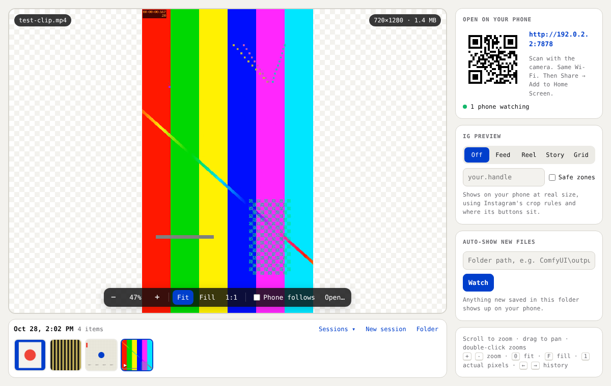
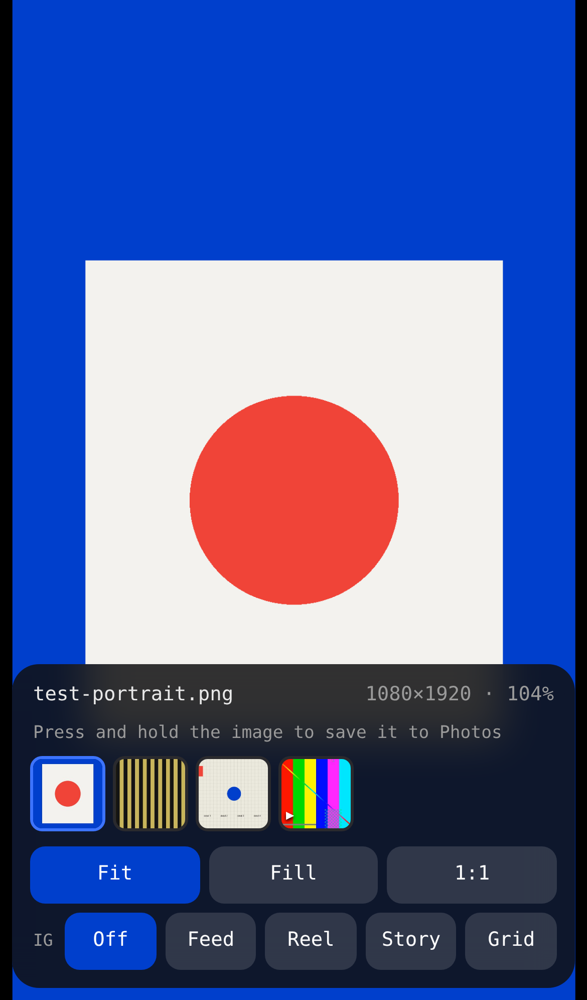
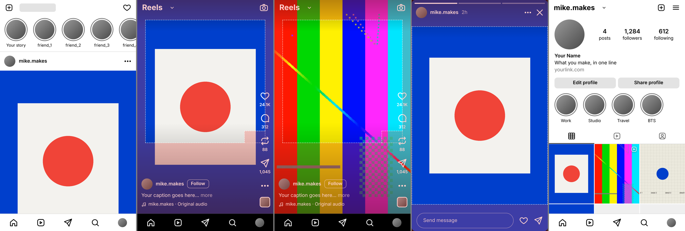

<div align="center">

# phone-ref

**Drop it on your computer. See it on your phone. Instantly.**

A tiny local tool for creatives: drag an image or video onto your desktop, and it appears full-screen on your iPhone a fraction of a second later. You can zoom in on both screens, look back through everything you've sent, and check how it'll crop on Instagram before you post.

[](media/demo.mp4)

<sub>▶ Click for the full 37-second demo ([16:9](media/demo.mp4) · [square](media/demo-square.mp4))</sub>

Windows · Mac · iPhone (any phone browser works) · Runs on your own Wi-Fi · No accounts, no cloud, no app store

</div>

---

## Why

Your screen lies. A render that looks great on a 32" monitor can fall apart on the 6" screen most people will actually see it on: text too small, detail lost, the subject cropped out by a caption.

AirDrop and messaging yourself both clutter your camera roll, and neither works well between Windows and an iPhone. phone-ref skips that. It's a **live reference view**: nothing is saved to the phone unless you ask, and the next file you drop replaces what's showing.

## What it does

| | |
|---|---|
| **Drop, paste or watch a folder** | Drag files in, paste with Ctrl+V / ⌘V, drag images straight out of a web UI like ComfyUI, or point it at an output folder. New renders appear on their own once they're fully written. |
| **Shows up instantly** | The phone updates live. Scan a QR code once, then add it to your Home Screen and it opens full-screen like an app. |
| **Zoom on both screens** | Wheel or pinch to zoom, drag to pan, Fit / Fill / 1:1 actual pixels. Tick **Phone follows** and the phone mirrors your desktop zoom live. |
| **History, saved per session** | A filmstrip of everything you've sent, on both screens. Swipe through it on the phone. Name sessions, start new ones and reopen old ones. |
| **IG preview** | See your file inside a Feed, Reel, Story or Profile Grid mock, with Instagram's real crop rules and Meta's recommended safe zones. |
| **Save to Photos** | Long-press an image on the iPhone → Save to Photos. |
| **Video that just works** | MP4/MOV with byte-range streaming (which iPhone Safari needs), autoplay, loop, and tap for sound. |

<p align="center">
  
  
</p>

## Use cases

- **AI image and video work.** Point phone-ref at your ComfyUI (or Krea, Midjourney downloads, Topaz…) output folder and every new render lands on your phone while you keep iterating. Check whether a generation holds up at phone size before you upscale it.
- **"Does it look the same?"** Hold the phone next to a reference, print or product and compare. 1:1 mode shows the file's real sharpness at the phone's real resolution.
- **Social content QA.** Flip into IG preview to see how a 9:16 poster gets cropped in the feed (it loses 25% top and bottom), whether a caption covers your subject in a Reel, and how a set of posts reads together on the 3:4 profile grid.
- **Client and team reviews.** Make a session per client or round ("Client X — round 2"), drop the options in, and hand someone the phone. They swipe through; you zoom from the desk with Phone follows on.
- **Design and UI mockups.** Check type sizes, tap targets and contrast on a real device at real size.
- **Video edits.** Drop an export and check pacing, legibility and framing on a phone before you upload anywhere.

## Quick start

**Download** the build for your system from [Releases](../../releases), unzip it, and run it:

- **Windows:** double-click `phone-ref.exe`
- **Mac:** double-click `phone-ref.command` (the first time, see the [Mac notes](docs/user-guide.md#first-time-on-a-mac))

A console window opens with a QR code, and the drop page opens in your browser. Scan the QR code with your iPhone camera. The phone needs to be on the same Wi-Fi.

**From source** (Node.js 18+):

```bash
npm run build     # assembles dist/phone-ref.mjs (single file, zero dependencies)
npm start         # runs it
```

Standalone binaries are built with [Bun](https://bun.sh): `npm run build:win`, `npm run build:mac`.

## IG preview

<p align="center"></p>

| Mode | What it shows |
|---|---|
| **Feed** | Photos display between 1.91:1 and 3:4. Anything outside that is center-cropped, and phone-ref tells you how much. |
| **Reel** | 9:16 with the caption, button column and tab bar in place. *Safe zones* marks ~14% top, 35% bottom and 6% sides, plus the button column. |
| **Story** | 9:16 card with the header and reply bar. *Safe zones* marks the top and bottom 250 px of 1920. |
| **Grid** | Your post as a 3:4 profile tile, next to everything else in the session. |

The mock follows Instagram's layout and published sizes as of October 2026, drawn with generic icons. It's for checking crops and placement, not a pixel copy. Details: [docs/ig-preview.md](docs/ig-preview.md).

## How it works

One small Node/Bun server runs on your computer. Your desktop browser is the drop page, and your phone's browser is the viewer. Live updates go over Server-Sent Events, and media streams with HTTP range requests. Only the computer running phone-ref can send files or change sessions; phones can only watch and browse. More in [docs/how-it-works.md](docs/how-it-works.md).

```
 ┌──────────── your computer ────────────┐            ┌──── iPhone ────┐
 │  drop page  ──PUT /push──▶  server    │──SSE──────▶│  viewer        │
 │  (browser)  ◀────SSE─────  (:7878)    │──/media───▶│  (Safari)      │
 │             watched folder ──▶        │◀─/select───│  swipe / tap   │
 └───────────────────────────────────────┘            └────────────────┘
```

## Docs

- [User guide](docs/user-guide.md): setup on Windows, Mac and iPhone, every feature, options, troubleshooting
- [Use cases](docs/use-cases.md): workflows in more detail
- [IG preview](docs/ig-preview.md): the crop rules and safe zones it uses, with sources
- [How it works](docs/how-it-works.md): architecture, endpoints, security model, building

## License

© 2026 Mike Clark. All rights reserved. The source is public so you can read it and see how it works; no license is granted to copy, modify or redistribute it. See [LICENSE](LICENSE). Includes [QR Code Generator for JavaScript](https://github.com/kazuhikoarase/qrcode-generator) © Kazuhiko Arase (MIT).

<div align="center"><sub>Made by <a href="https://mikeclark.design">Mike Clark</a> · Fractl Digitl</sub></div>
